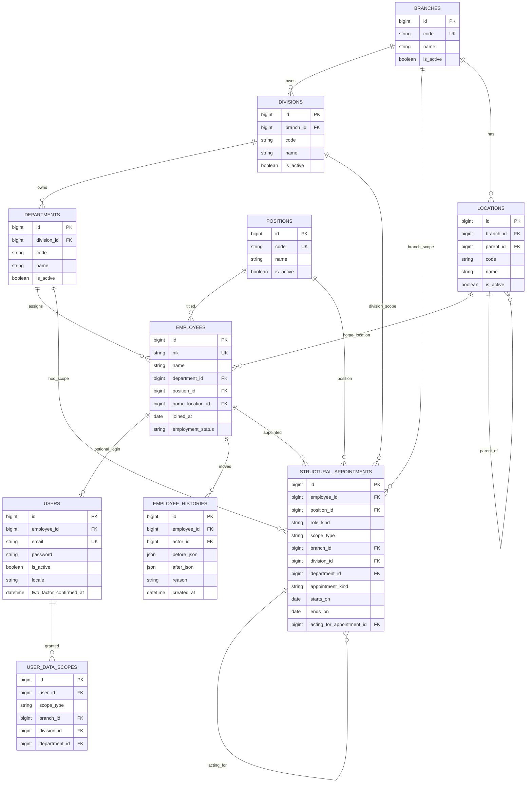
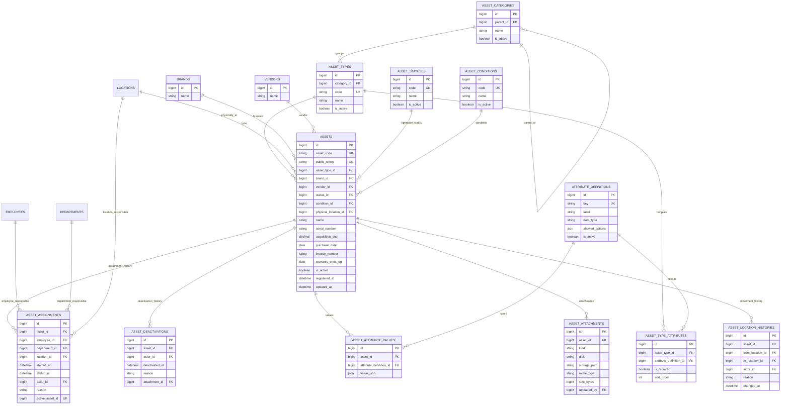
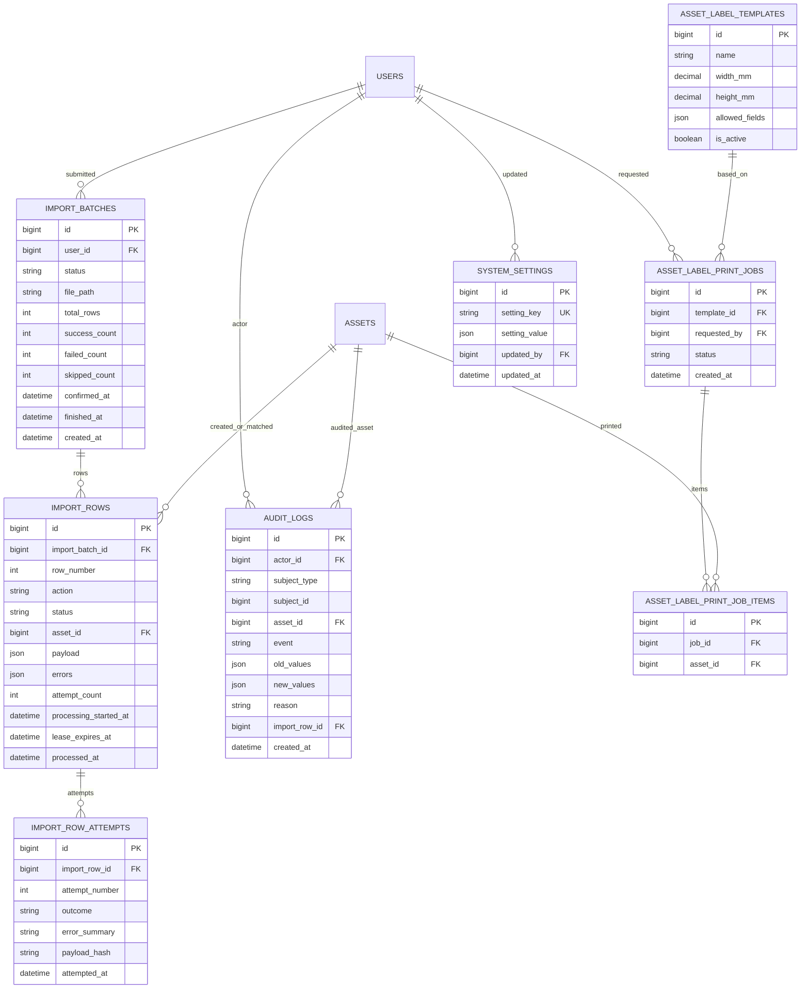
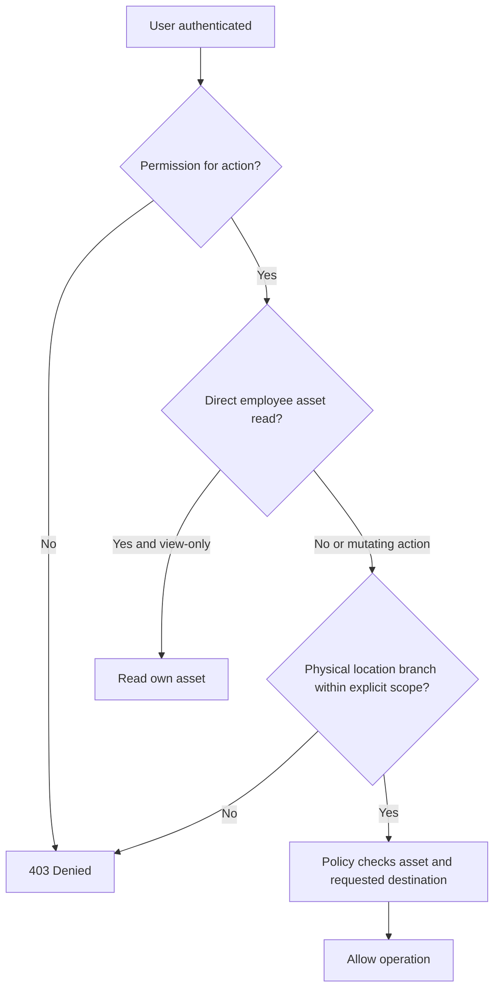

# ERD & Data Dictionary — Asset Management System

**Versi:** 1.0 Approved / Frozen | **Tanggal:** 2026-11-06  
**Status:** APPROVED / FROZEN — implementasi migration tetap memerlukan validasi teknis  
**Rujukan:** PRD v1.0 Approved / Frozen, Requirements Baseline v1.0, Decision Log V01–V16

## 1. Konvensi teknis dan batas desain
MySQL InnoDB; tabel plural snake_case; PK `BIGINT UNSIGNED`; FK eksplisit; UTC untuk timestamp; tanggal efektif pejabat berbasis `DATE`, batas awal/akhir **inklusif**. Foreign key menggunakan RESTRICT untuk entitas historis, bukan cascade hard-delete. Unik kode bisnis harus ditangani pada database, bukan hanya Laravel validation. Hindari polymorphic FK untuk penanggung jawab karena perlu referential integrity nyata.

**Status desain:** kolom utama dan aturan relasi tercantum di bawah, tetapi tipe SQL rinci/panjang varchar/indeks khusus akan direview pada tahap migration. `DECIMAL(18,2)` untuk acquisition cost adalah usulan teknis.

## 2. ERD inti — Organisasi, identitas, scope

**Otorisasi V16:** `assets.physical_location_id -> locations.branch_id` adalah cabang operasional yang menjadi dasar *asset scope* petugas. Cabang pemegang tanggung jawab **bukan** sumber izin mengelola. `users.employee_id -> employees.id -> asset_assignments.employee_id` memberi akses **baca pribadi** untuk item yang langsung ditugaskan pada user tersebut. Tetap cek permission dan kebijakan eksplisit pada aksi.

## 3. ERD inti — Master, aset, assignment, histori

`active_asset_id` **generated column** hanya untuk index yang unik pada penugasan aktif, bukan field aplikasi yang diinput. Ekspresi konseptual: `CASE WHEN ended_at IS NULL THEN asset_id ELSE NULL END`; `UNIQUE(active_asset_id)` memastikan paling banyak satu assignment aktif per aset. Penentuan nama dan sintaks DDL diuji pada versi MySQL target.

## 4. ERD — Impor, audit, labels, settings

**Catatan:** `AUDIT_LOGS.asset_id` FK nullable dipakai saat subject adalah aset agar laporan event dapat join scoped assets tanpa mengandalkan polymorphic `subject_type` saja. Log untuk user/employee/role memakai subject_type/id tanpa asset_id. `AUDIT_LOGS.import_row_id` nullable untuk traceability. Ada tabel paket Laravel/Spatie: `roles`, `permissions`, `model_has_roles`, `model_has_permissions`, `role_has_permissions`, `notifications`, `jobs`, `job_batches`, `failed_jobs`, `sessions` dan password resets/2FA mengikuti stack aktual.

## 5. Data dictionary dan nullability kunci
| Entitas | Primary attributes | Constraint / semantik |
|---|---|---|
| `branches` | `id, code, name, is_active` | `code` unique, referensi historis RESTRICT |
| `divisions` | `id, branch_id, code, name` | unique `(branch_id,code)`; bukan shared antarcabang |
| `departments` | `id, division_id, code, name` | unique `(division_id,code)` |
| `employees` | `nik, name, department_id, position_id, home_location_id, joined_at, employment_status` | NIK NOT NULL UNIQUE, immutable/reuse prevention aplikasi; dapat tanpa user |
| `users` | `employee_id,email,password,is_active,locale,2FA metadata` | `employee_id` NOT NULL UNIQUE, `email` NULLABLE UNIQUE + casefold normalization; password hashed |
| `structural_appointments` | `employee_id,position_id,role_kind,scope_type,[scope_fk],appointment_kind,starts_on,ends_on` | HOD department; Director division/branch/company; scope FK tepat mengikuti jenis; tanggal `ends_on>=starts_on` |
| `locations` | `branch_id,parent_id,name,code` | parent harus di cabang sama, anti-siklus; unique code per branch (proposed) |
| `assets` | `asset_code,public_token,asset_type_id,name,physical_location_id,status_id,condition_id,purchase_date,acquisition_cost,is_active` | semua wajib kecuali yang eksplisit opsional; code/token UNIQUE, `acquisition_cost>=0`; default Tersedia/Baik di service/seed bukan default FK angka keras |
| `assets` opsional | `brand_id,vendor_id,serial_number,invoice_number,warranty_ends_on` | nullable; serial number bukan unique wajib |
| `asset_assignments` | `asset_id,[employee_id,department_id,location_id],started_at,ended_at,actor_id,reason` | tepat satu FK target; waktu valid; unique generated active asset |
| `asset_location_histories` | `asset_id,from_location_id,to_location_id,actor_id,reason,changed_at` | histori immutable aplikasi; `from_location_id` nullable saat create |
| `asset_deactivations` | `asset_id,actor_id,deactivated_at,reason,attachment_id` | alasan wajib, attachment opsional |
| `asset_attribute_values` | `asset_id,attribute_definition_id,value_json` | unique `(asset_id,attribute_definition_id)`; type validation di Laravel |
| `import_batches` | `user_id,status,counts,source_file` | 1000 row maksimum; retensi file/hasil sementara 90 hari |
| `import_rows` | `import_batch_id,row_number,action,status,attempt_count,asset_id` | unique `(import_batch_id,row_number)`; success terminal, failed explicit retry |
| `import_row_attempts` | `import_row_id,attempt_number,outcome,payload_hash` | unique `(import_row_id,attempt_number)`; bukti retry dan koreksi |
| `audit_logs` | `actor_id,subject_type,subject_id,asset_id,event,old_values,new_values,reason,created_at` | append-only aplikasi, redaksi secrets, tidak purge otomatis |
| `user_data_scopes` | `user_id,scope_type,branch_id,division_id,department_id` | tepat satu scope FK untuk jenis scope; Super Admin global via Policy, bukan FK NULL ambigu |

## 6. Database invariants (critical)
1. **Assignment:** exactly one of `employee_id`, `department_id`, `location_id` NOT NULL (`CHECK` sum of boolean expressions = 1). `ended_at` NULL berarti assignment aktif; `CHECK ended_at IS NULL OR ended_at > started_at`.
2. **Aset aktif:** `is_active=true` => **tepat satu** assignment dengan `ended_at IS NULL`; nonaktif => **nol**. Unique generated column membuktikan **maksimal satu**; kewajiban **minimal satu** adalah invariant lintas tabel, ditegakkan action dengan transaksi+asset row lock+tes, tidak bisa oleh `CHECK` tunggal.
3. **Deactivation/reactivation:** transaksi menyimpan state, assignment, record lifecycle, audit bersama; setiap jalur tulis, termasuk import, memanggil action terstandar.
4. **Appointment:** maksimal satu definitive dan satu acting pada unit/peran di setiap tanggal. Acting prioritas. MySQL tidak punya exclusion constraint interval umum: lock satu row scope-key stabil (tabel `structural_appointment_scope_locks` yang dikunci dengan `SELECT ... FOR UPDATE`) dan cek overlap transaksional. Scope company memakai sentinel non-null unik; tanggal inklusif.
5. **Tree:** categories/locations tidak boleh membuat lingkaran; lokasi anak sama branch dengan induk; validasi ancestor+locking atau serialization di action dan tes race-condition.
6. **Identifier:** nomor aset global via `asset_number_sequences` single atomic row lock; code tidak pernah diterbitkan saat preview. Asset code/QR token unique; NIK unique permanen walaupun employee nonaktif. Email unique jika terisi, case-insensitive canonicalization.
7. **Import idempotency:** status successful + audit + asset commit **bersamaan**. Worker mengambil/claim row dengan transaksi dan lease, mengecek sukses sebelumnya, memproses/revalidasi/recheck permission dan melakukan commit atomik. `processing` dengan lease kedaluwarsa direkonsiliasi sebelum retry; duplicate jobs aman. Row failed diperbaiki lewat attempt baru yang dilacak; row sukses immutable.
8. **Read isolation & scope:** semua query asset policy memakai **current physical_location->branch** dan scope explicit; personal view employee melihat direct assignment saja, tanpa edit kecuali permission khusus. Job export dan label memeriksa scope ulang pada eksekusi. Snapshot audit event tidak memberi akses baca jika aset sudah di luar scope saat permintaan laporan.
9. **No hard delete:** aset/master yang direferensikan memakai restrict + soft disable. Semua audit before/after tersanitasi dan histori domain tidak diedit diam-diam.

## 7. Indeks yang direkomendasikan
- `assets`: unique(asset_code), unique(public_token), index(physical_location_id,is_active), index(asset_type_id,status_id), index(purchase_date), index(registered_at), index(updated_at).
- `asset_assignments`: unique(active_asset_id) generated, index(asset_id,ended_at), index(employee_id,ended_at), index(department_id,ended_at), index(location_id,ended_at).
- `audit_logs`: index(asset_id,created_at), index(event,created_at), index(subject_type,subject_id,created_at).
- `import_rows`: unique(import_batch_id,row_number), index(import_batch_id,status), index(status,lease_expires_at).
- `structural_appointments`: index(role_kind,scope_type,starts_on,ends_on,appointment_kind); overlap enforcement **bukan** dari index ini.
- `employees`: unique(nik); `users`: unique(employee_id), unique(email) non-null.

## 8. Transaction boundaries
| Action | Lock dan transaksi | Commit bersama |
|---|---|---|
| `RegisterAsset` | lock global sequence, validate location/scope | assets, assignment awal, location history, audit, row success jika import |
| `ReassignAsset` | lock assets.id | close existing assignment, insert new, audit |
| `MoveAssetLocation` | lock assets.id; authorization source+destination | update physical_location, movement history, audit |
| `DeactivateAsset` | lock assets.id | close assignment, is_active=false, record deactivation, audit |
| `ReactivateAsset` | lock assets.id | new assignment, is_active=true, audit |
| `TransferEmployee` | lock employee, evaluate active assigned assets | change placement, employee history, audit, notification queued after-commit |
| `AssignStructuralOfficer` | lock structural scope key | overlap check, appointment change, audit |
| `ProcessImportRow` | claim/lease, lock matched asset or seq | validation, asset mutation, audit, row success; distinct rows isolated |

Batasan teknis **proposed** untuk review: locking scope-unit dan lease worker; belum perlu disahkan sebagai detail SQL sampai migration dan test concurrency divalidasi. Seluruh notifikasi dan file processing yang bukan bagian transaksi dapat dijadwalkan **after-commit**.

## 9. Diagram izin operasional (bukan FK tambahan)

## 10. Migration order dan audit
1. Branch/division/department/position/location; employee/user + Spatie tables.
2. Scopes, employee histories, appointment scope locks and structural appointments.
3. Category/type/attribute definitions/status/condition/brand/vendor.
4. Asset number sequence, assets, attributes, assignments and generated active unique constraint, physical histories, attachments, deactivation.
5. Audit logs, import batch/row/attempt, labels, notifications, queue, settings.
6. Seed reserved status Tersedia + kondisi Baik with stable **codes** (not hard-coded numeric IDs); seed default role/permissions.

**Review required before freezing migration:** verify exact MySQL version for functional/generated-column/check behavior; normalize case-insensitive email; decide whether `employee_histories` snapshots or typed old/new FKs are needed for future as-of (not MVP). This does not change any decided business rule. Test concurrency with real MySQL (not SQLite-only).
